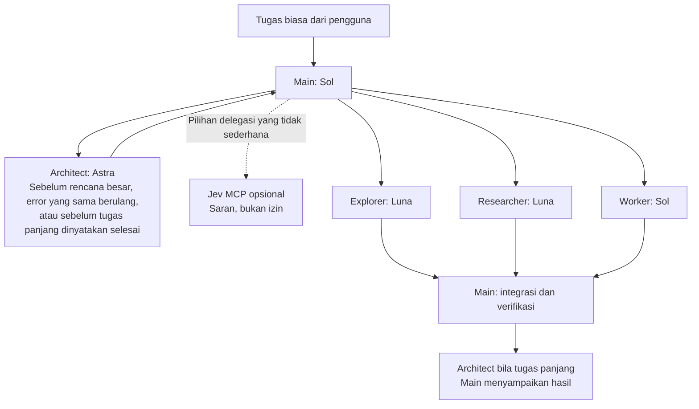

# Codex Agent Kit

Konfigurasi agen Codex pribadi yang dapat dipasang ulang di perangkat lain. Beri tugas biasa: Codex menentukan kapan perlu meninjau rencana, mengeksplorasi kode, mencari sumber, atau mendelegasikan implementasi.

Paket ini memindahkan **konfigurasi dan aturan kerja**. Aturan workflow adalah instruksi yang diikuti agen, bukan scheduler yang menjamin setiap keputusan runtime. Login, akses model, serta koneksi layanan tetap disiapkan di setiap perangkat. Agen dipanggil saat diperlukan; memasang paket tidak langsung menjalankan semua agen.

| Peran | Model bawaan | Reasoning | Tugas |
| --- | --- | --- | --- |
| Main | `gpt-6.1-sol` | high | Koordinasi, implementasi, integrasi dan verifikasi |
| Architect | `gpt-6-astra` | high | Review rencana besar, error berulang, dan hasil tugas panjang |
| Worker | `gpt-6.1-sol` | medium | Implementasi terarah, pemeriksaan proporsional, dan laporan hasil aktual |
| Explorer | `gpt-6-luna` | medium | Menelusuri kode tanpa mengedit |
| Researcher | `gpt-6-luna` | medium | Mengumpulkan bukti dan dokumentasi tanpa mengedit |
| Jev (opsional) | `jev-1.13.0` | — | Saran delegasi dan penilaian perubahan melalui TypeSafe |



Default: **3 thread subagen yang terbuka bersamaan**, di luar agen utama, sehingga totalnya **4 agen termasuk main**. Architect memakai slot subagen yang sama; jalankan review secara bertahap bila tiga slot sedang terpakai. Kapasitas efektif mengikuti batas klien/runtime yang lebih rendah.

Main memeriksa bukti dari subagen, mengintegrasikan hasil, dan melakukan verifikasi akhir. Jev yang disertakan hanya memberi saran delegasi dan review perubahan; kit ini belum mengotomatisasi setiap keputusan file, tool, atau retry. Pengaturan approval dan sandbox tetap mengikuti konfigurasi perangkat Anda; kit tidak mengaktifkan `auto_review`.

## Persiapan

- Git, Python **3.11 atau lebih baru**, dan Codex CLI yang mendukung standalone custom agents. Konfigurasi diperiksa terhadap `codex-cli 0.163.0`.
- Instal Codex mengikuti [petunjuk resmi](https://learn.chatgpt.com/docs/codex/cli), lalu jalankan `codex login` di perangkat tersebut.
- Pastikan akun/provider Anda memiliki akses ke model pada tabel. Default ini dipilih untuk akun yang menguji kit, bukan jaminan ketersediaan universal. Jika perlu, edit `config/base.toml` dan `config/agents/*.toml` **sebelum memasang**. Paket ini tidak memberikan akses model.
- Tutup sesi Codex sebelum mengubah konfigurasi. Mulai sesi baru setelah pemasangan.

## macOS / Linux / WSL

```bash
git clone https://github.com/badriawan/codex-agent-kit.git
cd codex-agent-kit
python3 -m venv .venv
.venv/bin/python -m pip install -r requirements.txt
.venv/bin/python install.py install --dry-run
.venv/bin/python install.py install
codex
```

Pada Debian/Ubuntu, bila `venv` gagal karena `ensurepip` tidak tersedia, pasang paket `python3-venv` melalui pengelola paket OS, kemudian ulangi pembuatan `.venv`. WSL memiliki direktori home Linux tersendiri; pemasangannya terpisah dari Windows native.

## Windows (PowerShell)

```powershell
git clone https://github.com/badriawan/codex-agent-kit.git
cd codex-agent-kit
py -3 -m venv .venv
.\.venv\Scripts\python.exe -m pip install -r requirements.txt
.\.venv\Scripts\python.exe install.py install --dry-run
.\.venv\Scripts\python.exe install.py install
codex
```

Pastikan `py -3` memilih Python 3.11+. Tidak perlu mengaktifkan environment atau mengubah execution policy PowerShell. Dukungan Codex native/WSL dijelaskan pada [dokumentasi Windows](https://learn.chatgpt.com/docs/windows/windows-sandbox).

Jika repositori ini private, autentikasikan GitHub pada perangkat tujuan terlebih dahulu, misalnya `gh auth login` dan `gh auth setup-git`, atau clone dengan SSH yang sudah Anda siapkan.

## Ponsel, tablet, dan aplikasi lain

Untuk iPhone/iPad/Android, gunakan perangkat tersebut sebagai klien ke komputer/server yang menjalankan Codex CLI, misalnya melalui SSH. Pasang kit pada komputer/server tersebut. Konfigurasi ini tidak otomatis terpasang pada aplikasi ChatGPT, antarmuka web, atau platform agen lain; setiap klien perlu mendukung format dan kemampuan delegasi yang sama. Tidak ada janji eksekusi native di semua perangkat.

## Yang dipasang

Installer membaca `CODEX_HOME` jika sudah tersedia, selain itu memakai `~/.codex` (home pengguna Windows juga didukung). Anda dapat menentukan tujuan sendiri:

```bash
python install.py install --codex-home "/path with spaces/codex"
```

Gunakan interpreter `.venv` seperti contoh OS di atas untuk semua perintah `python install.py` berikut.

- `config.toml`: gabungkan hanya `model`, `model_reasoning_effort`, `agents.enabled`, dan `agents.max_concurrent_threads_per_session`.
- `agents/{architect,worker,explorer,researcher}.toml`: pasang empat peran. File lama dicadangkan dan dipulihkan saat uninstall.
- `AGENTS.md`: tambahkan blok workflow bertanda; instruksi lain dipertahankan. Instruksi proyek yang lebih spesifik dan kebijakan runtime tetap berlaku.
- `.agent-kit/`: manifest pemulihan, journal transaksi, dan backup lokal. Folder ini **tidak boleh diunggah**; backup dapat berisi konfigurasi pribadi.

Installer memakai TOML Kit untuk menjaga struktur dan komentar konfigurasi. Konfigurasi login, permission/sandbox, MCP, plugin, dan proyek lain dipertahankan. Nilai konfigurasi lain tidak dicetak.

Pada POSIX, direktori state/backup memakai mode privat. Pada Windows, perlindungan mengikuti ACL profil pengguna; `chmod` Python bukan pengganti ACL Windows.

Jika `AGENTS.override.md` ada, installer berhenti karena file itu mendahului `AGENTS.md`. Gabungkan kebijakan yang diinginkan secara sadar lalu hapus/pindahkan override sebelum memasang. Jika konfigurasi lama masih memakai `agents.max_threads`, ubah ke nama `max_concurrent_threads_per_session` terlebih dahulu. Deklarasi `[agents.<role>]` dengan empat nama yang sama juga perlu diselesaikan lebih dulu untuk menghindari dua sumber konfigurasi.

## Periksa, perbarui, dan hapus

```bash
python install.py status
python install.py tree
git pull --ff-only
python -m pip install -r requirements.txt
python install.py install --dry-run
python install.py install
```

`tree` menampilkan peran bawaan kit, pemicu architect, Jev sebagai penasihat opsional, dan batas subagen dari template konfigurasi. Output ini bukan daftar agen yang sedang berjalan dan tidak menampilkan angka aktivitas sesi. `status` memeriksa file/settings yang dikelola, bukan autentikasi atau keberhasilan akses model. Instalasi berulang tanpa perubahan tidak menulis ulang file atau menambah blok instruksi.

Untuk menghapus:

```bash
python install.py uninstall --dry-run
python install.py uninstall
```

Uninstall mengembalikan bagian yang dikelola dan mempertahankan perubahan lain yang Anda buat setelah instalasi. Backup lokal tetap disimpan.

Jika Anda mengedit model/settings yang dikelola, file role, atau isi blok workflow, installer berhenti tanpa menimpa edit tersebut. **Simpan salinan edit Anda terlebih dahulu.** Untuk melanjutkan, pulihkan bagian yang dikelola ke versi yang terakhir dipasang (lihat backup/manifest lokal), jalankan uninstall, kemudian terapkan penyesuaian Anda atau edit template kit dan pasang ulang. Jangan membagikan manifest/backup karena dapat berisi konfigurasi pribadi. Edit di luar blok `AGENTS.md` atau pada setting lain tidak menghalangi uninstall.

Jika proses terputus mendadak, installer mendeteksi journal sebelum menjalankan perubahan berikutnya:

```bash
python install.py recover --dry-run
python install.py recover
```

Gunakan `--codex-home` yang sama bila sebelumnya ditentukan. Recovery mengembalikan transaksi yang terputus; edit baru setelah interupsi akan dideteksi sebagai konflik dan perlu disimpan terlebih dahulu. Jangan jalankan dua installer bersamaan.

## Jev opsional

Kit inti bekerja tanpa Jev. Server MCP, skill `$jev`, dependensi, tes, serta petunjuk konfigurasi per perangkat ada di [integrations/jev](integrations/jev/README.md). Siapkan `TYPESAFE_API_KEY` secara lokal; kunci tidak disimpan di repo atau dipindahkan antardevice. Panggilan Jev memakai akun TypeSafe dan dapat menimbulkan biaya. Saran Jev tidak menggantikan review architect atau memberi izin eksekusi/publikasi.

## Verifikasi

```bash
python -m unittest discover -s tests -v
```

Tes installer menggunakan direktori sementara: pemasangan baru/berulang, dry-run, TOML kompleks, pelestarian instruksi dan file lama, uninstall setelah perubahan lain, deteksi konflik, symlink, rollback kegagalan, dan pemulihan proses terputus.

GitHub Actions menjalankan tes installer, tes offline Jev, dan discovery MCP pada Ubuntu, macOS, dan Windows dengan Python 3.11/3.13. Periksa status workflow repositori sebelum menganggap ketiganya telah lulus. Tes ini tidak membuktikan akses akun terhadap setiap model atau memanggil API berbayar.

## Referensi

- [Custom agents dan pengaturan subagen](https://learn.chatgpt.com/docs/agent-configuration/subagents)
- [Instruksi global dan proyek melalui AGENTS.md](https://learn.chatgpt.com/docs/agent-configuration/agents-md)
- [Referensi konfigurasi Codex](https://learn.chatgpt.com/docs/config-file/config-reference)
- [TOML Kit](https://tomlkit.readthedocs.io/en/latest/quickstart/)
